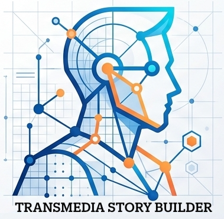

# TSB: Transmedia Story Builder 

**TSBuilder** 1.0 CCBY mgea, 12/10/2026 

 

Plataforma ligera para la gestión, visualización y diseño de proyectos de narrativa transmedia 

Contiene:  

* ``index.html`` Browser para catálogos de proyectos (que se almacenan en carpetas con formato JSON)
* ``TSB.html`` que es un visualizador de una sola ficha 
* ``story.json`` (ejemplo de ficha)

Usado en [Creatividad e Innovación Audiovisual](https://github.com/mgea/criav) (Grado en Comunicación Audiovisual) edición 2026/27


## 1. Objetivo y Funcionamiento

### Objetivo 
El objetivo principal de **TSB Transmedia StoryBuilder** es proporcionar una herramienta sencilla para  centralizar el diseño de sus universos narrativos. Con un planteamiento similar (pero más simplificado) a una Biblia transmedia, lo que hace es recoger todo el universo de la narrativa, centrandose en los personajes y los productos desarrollados. 

Permite articular en un único espacio la descripción del proyecto, la ficha de los autores/colectivos, las biografías y perfiles psicológicos de los personajes, los módulos interactivos embebidos y la red de conexiones multiplataforma (podcasts, cómics, videojuegos, ARGs, etc.).

Actualmente se utiliza en la Asignatura *Creatividad e Innovación Audiovisual* para el diseño de personajes, histórias y productos, así como la descripcion del proceso creativo. Los repositorios de proyectos están en https://github.com/mgea/storytelling Todo el contenido se almacena en fichas en formato JSON

 

### Funcionamiento
El funcionamiento del sistema se basa en un paradigma **data-driven** (guiado por datos):

* **Procesamiento de Datos (JSON):** La aplicación utiliza una estructura de datos estándar definida en un archivo `story.json`. Al iniciar, la aplicación intenta realizar una lectura automática (`fetch`) de este fichero en la raíz del proyecto.
* **Manejo Dinámico de Fichas:** En caso de que se arrastre o cargue un archivo JSON mediante el selector manual de la interfaz, un lector local (`FileReader`) procesa el contenido directamente en la memoria del navegador, sin necesidad de subir archivos a un servidor externo.
* **Motor de Renderizado Dinámico:** La lógica en JavaScript interpreta las claves del archivo JSON y las traduce en componentes visuales:
  * Inyecta las redes sociales (RRSS) y avatares directamente debajo de los bloques de Grupo y Autores respetando una alineación en cuadrícula.
  * Renderiza dinámicamente las pestañas de selección para navegar entre personajes sin recargar la página.
  * Modifica y limpia sobre la marcha los códigos embed (iFrames) para neutralizar dimensiones fijas no adaptativas.
* **Sincronización Dual (Visor / Editor):** La aplicación incluye un editor JSON integrado que sincroniza el código en tiempo real con el visor visual, permitiendo exportar el resultado final actualizado en cualquier momento.


## 2. Aspectos Técnicos y de Desarrollo

### Arquitectura y Tecnologías
La plataforma está construida bajo una arquitectura **SPA (Single Page Application)** cliente utilizando únicamente tecnologías web nativas, sin necesidad de compilación o dependencias de *build tools* (Node.js/npm):

* **HTML5:** Estructura semántica de la interfaz y contenedores flexibles para la inyección del DOM.
* **CSS3 & Tailwind CSS (v3 CDN):** Sistema de diseño basado en principios de *Flat Design Minimalista*. Utiliza clases de utilidad para la distribución responsiva (`flexbox`, `grid`) y tipografía personalizada.
* **JavaScript (Vanilla ES6+):** Gestión completa de la lógica de negocio, manipulación del DOM, parsing de JSON, lector de archivos locales y eventos de la interfaz (*Drag & Drop*, cambio de vistas, modales).

### Componentes Clave y Estilos Relevantes
* **Tipografías:** Integración de *Space Grotesk* (para títulos y encabezados de estética geométrica) y *Plus Jakarta Sans* (para texto de lectura).
* **Iconografía:** Integración de *FontAwesome 6* con lógica automática en JS para mapear nombres de plataformas (ej. *"Twitter"*, *"Instagram"*, *"GitHub"*) a sus respectivos iconos vectoriales.
* **Incrustación Responsiva de Experiencias:** Implementación de la función `makeResponsiveEmbed()`, la cual analiza el código HTML inyectado en la clave `embed` de la experiencia (por ejemplo, módulos interactivodes de H5P, vídeos o iFrames externos) y normaliza sus propiedades CSS para garantizar un comportamiento completamente *responsive* mediante la propiedad CSS `clamp()`.
* **Identificación de Estructura:**
  * Dimensiones estandarizadas para elementos circulares de avatar y RRSS ($80 \times 80\text{ px}$).
  * Paleta de color basada en tonos crema, beis y terracota (`#D96B43`).

## 3. Ficha de contenidos (story.json)

Cada ficha contiene información del proyecto transmedia que se organiza del siguiente modo:

#### 1. Datos Generales del Proyecto

- **`titulo`** *(Texto)*: Nombre principal de la obra transmedia.
- **`descripcion`** *(Texto)*: Sinopsis extendida del proyecto y su propuesta narrativa.
- **`palabrasClave`** *(Lista de textos)*: Etiquetas para categorizar el proyecto (géneros, temas, formatos).
- **`imagen`** *(Texto/Ruta)*: Ruta local o URL de la imagen/logo representativo de la obra.
- **`grupo`** *(Texto)*: Nombre de la asignatura, colectivo, empresa o equipo de trabajo.
- **`autores`** *(Texto)*: Nombres de los integrantes o creadores.
- **`fecha`** *(Texto)*: Año de creación o edición.
- **`version`** *(Texto)*: Versión de la ficha (ej. `"1.0"`).

#### 2. Redes Sociales y Equipo

  (opcional, si no se pone nada no aparece en ficha)

- **`RRSS`** *(Lista de objetos)*:
  - **`nombre`** *(Texto)*: Nombre de la red (ej. `"Twitter"`, `"Instagram"`, `"GitHub"`, `"Web Oficial"`). *Si reconocemos el nombre, se asignará su icono de FontAwesome automáticamente.*
  - **`link`** *(URL)*: Enlace directo a la red social o plataforma.
  - **`img`** *(Ruta/URL)*: Imagen personalizada si no se utiliza un nombre de red reconocido.
- **`Avatar`** *(Lista de objetos)*:
  - **`nombre`** *(Texto)*: Nombre del integrante del equipo.
  - **`link`** *(URL)*: Enlace al perfil personal (GitHub, LinkedIn, portfolio).
  - **`img`** *(Ruta/URL)*: Foto de perfil o avatar en formato circular.

#### 3. Fichas de Personajes (`personajes`)

Array de objetos donde cada elemento representa un personaje clave:

- **`nombre`** *(Texto)*: Nombre y apellido del personaje.
- **`cita`** *(Texto)*: Cita textual que sintetiza la personalidad del personaje.
- **`biografia`** *(Texto)*: Historia de origen y rol en el universo.
- **`objetivo`** *(Texto)*: La meta que persigue.
- **`conflicto`** *(Texto)*: Obstáculo principal en su viaje.
- **`etiquetas`** *(Lista de textos)*: Roles rápidos (ej. `["Protagonista", "Hacker"]`).
- **`url`** *(Ruta/URL)*: Imagen del personaje.
- **`alt`** *(Texto)*: Descripción accesible de la imagen.
- **`personalidad`**, **`motivacion`**, **`habilidades`**, **`debilidades`**: Desglose de atributos psicológicos y operativos.
- **`secreto`** *(Texto)*: Revelación clave para la trama.

#### 4. Experiencias Interactivas (`experiencias`)

Array de módulos interactivos o galerías. Soporta dos estructuras según el atributo **`tipo`**:

- **Tipo `"incrustado"`**:
  - **`experiencia`** *(Texto)*: Título del contenido.
  - **`descripcion`** *(Texto)*: Explicación didáctica o narrativa.
  - **`embed`** *(HTML en texto)*: Código iframe o HTML embebido (recursos H5P, reproductores de vídeo/audio, etc.).
- **Tipo `"galeria"`**:
  - **`experiencia`** *(Texto)*: Título de la colección de imágenes.
  - **`url`** *(Lista de URLs)*: Conjunto de imágenes a mostrar en el selector de Retícula / Carrusel

#### 5. Mapa de Conexiones Narrativas (`conexiones`)

Array de enlaces externos a otras ventanas o plataformas del universo transmedia:

- **`plataforma`** *(Texto)*: Título del medio (ej. `"Cómic Web 'Sector 8'"`).
- **`tipo`** *(Texto)*: Formato narrativo (ej. `"Audio-novela"`, `"Videojuego Web"`).
- **`imagen`** *(Ruta/URL)*: Miniatura promocional del enlace.
- **`enlace`** *(URL)*: Dirección de destino al hacer clic en el botón de acceso.

#### 6. Proceso de Diseño & Metodología (`procesoDisenoMetodologia`)

Objeto que documenta las fuentes de inspiración, el marco de trabajo y la pila tecnológica utilizada:

- **`inspiracion`** *(Objeto)*:
  - **`referentes`** *(Lista de textos)*: Influencias culturales, obras de referencia o conceptos visuales clave.
  - **`moodboardUrl`** *(URL)*: Enlace al tablero visual o repositorio de referencias (Pinterest, Behance, Figma).
  - **`palabraConcepto`** *(Texto)*: Descripción conceptual del diseño, estilo visual o paleta de color.
- **`metodologia`** *(Objeto)*:
  - **`marcoframing`** *(Texto)*: Metodología o marco conceptual aplicado (ej. *"Design Thinking & Transmedia Storytelling Canvas"*).
  - **`fasesProceso`** *(Lista de textos)*: Listado ordenado de las etapas del proyecto desde la investigación hasta la producción.
- **`herramientas`** *(Lista de objetos)*:
  - **`categoria`** *(Texto)*: Ámbito de trabajo (ej. `"Diseño UI/UX"`, `"Desarrollo & Prototipado"`, `"Gestión"`).
  - **`items`** *(Lista de textos)*: Software, lenguajes o herramientas usadas (ej. `["Figma", "Tailwind CSS", "H5P"]`).


## 4. Apectos técnicos 


#### 4.1 Incrustación de experiencias interactivas

En la sección de *Experiencias Interactivas*, en caso de ser un recurso incrustado (embebido) mediante *iframes* , a la hora de incluir el código HTML embebido se debe **convertir a una cadena de texto en formato JSON (JSON string)**. 

Por ejemplo, el siguiente iframe 

```
<iframe src="https://h5p.org/h5p/embed/1076188" width="1090" height="479" frameborder="0" allowfullscreen="allowfullscreen" allow="geolocation *; microphone *; camera *; midi *; encrypted-media *" title="Quizz Personalidad: Star Wars"></iframe><script src="https://h5p.org/sites/all/modules/h5p/library/js/h5p-resizer.js" charset="UTF-8"></script>

```

Se debe convertir a JSON string para añadirlo como el campo "url"

```
"embed": "<iframe src=\"https://h5p.org/h5p/embed/1076188\" width=\"1090\" height=\"479\" frameborder=\"0\" allowfullscreen=\"allowfullscreen\" allow=\"geolocation *; microphone *; camera *; midi *; encrypted-media *\" title=\"Quizz Personalidad: Star Wars\"></iframe><script src=\"https://h5p.org/sites/all/modules/h5p/library/js/h5p-resizer.js\" charset=\"UTF-8\"></script>"

```

Para convertirlo el una cadena que luego se pueda interpretar correctamente, hay que hacer: 

* **Escapado de caracteres especiales** (El uso de la barra invertida `\`). En programación, las comillas dobles (`"`) se utilizan para indicar dónde empieza y dónde termina un texto. Como tu código HTML ya tiene muchas comillas por dentro (por ejemplo, `width="1090"`), un sistema informático se confundiría y pensaría que el texto termina antes de tiempo.

  Para evitarlo, la conversión añade una **barra invertida (`\`)** justo antes de cada comilla interna. Esto le dice al sistema: *"Ojo, la comilla que viene a continuación es parte del texto visual, no es el final de la cadena"*

  - **Antes:** `width="1090"`
  - **Después (Convertido):** `width=\"1090\"`


* **Unificación en una sola línea de texto**. El formato JSON requiere que los bloques de texto planos viajen como una **única línea continua de caracteres**. La conversión elimina cualquier salto de línea real y, si son necesarios, los reemplaza por el símbolo `\n`. En tu caso, al juntar la etiqueta `<iframe>` y `<script>`, se asegura de que todo viaje en un solo bloque compacto.


Para evitar errores en este proceso, se puede **pedir a cualquier IA que convierta el código HTML en un JSON string correcto.** 


-----

TSBuilder es un proyecto para Creatividad e Innovacion Audiovisual 

CCBY Miguel Gea, 2026